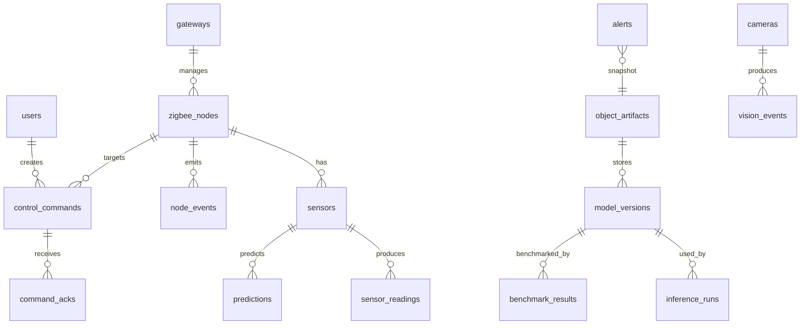

# 数据库设计

## 1. 设计原则

数据库采用 PostgreSQL。设计继承 `AgriNex` 的 Device-Sensor-Reading 三层结构，并吸收 `Breezio-backend` 中 current state、control action、alarm 和 gateway 状态的语义。PostgreSQL 适合本项目的原因是它提供 `TIMESTAMPTZ`、`JSONB`、表达式索引、强约束和成熟的时间序列扩展空间，能更自然地保存传感器数据、视觉事件、模型指标和对象存储元数据。

大对象不直接存入 PostgreSQL。摄像头快照、训练集、模型权重、ONNX 文件、benchmark JSON、混淆矩阵和训练曲线保存到 S3-compatible 对象存储；PostgreSQL 只保存对象 key、哈希、大小、类型和关联元数据。

## 2. 核心实体关系



## 3. 表设计

### 3.1 `users`

平台用户表。

| 字段 | 类型 | 说明 |
| --- | --- | --- |
| `id` | BIGSERIAL PK | 用户 ID |
| `name` | VARCHAR(120) | 显示名称 |
| `email` | VARCHAR(160) UNIQUE | 登录邮箱 |
| `password_hash` | VARCHAR(255) | 密码哈希 |
| `role` | VARCHAR(20) | `admin` / `operator` / `viewer` |
| `status` | VARCHAR(20) | `active` / `invited` / `disabled` |
| `settings` | JSONB | 用户偏好，例如 `theme_mode` 和通知开关 |
| `last_login` | TIMESTAMPTZ NULL | 最近登录时间 |
| `created_at` | TIMESTAMPTZ | 创建时间 |
| `updated_at` | TIMESTAMPTZ | 更新时间 |

索引：`uk_user_email(email)`、`idx_user_role(role)`、`idx_user_status(status)`。

### 3.2 `gateways`

边缘网关状态表。

| 字段 | 类型 | 说明 |
| --- | --- | --- |
| `id` | BIGSERIAL PK | 内部 ID |
| `gateway_id` | VARCHAR(64) UNIQUE | 网关业务 ID，如 `gw-01` |
| `name` | VARCHAR(128) | 网关名称 |
| `location` | VARCHAR(255) | 部署位置 |
| `status` | VARCHAR(20) | `online` / `offline` / `degraded` |
| `ip_address` | VARCHAR(45) | IP 地址 |
| `version` | VARCHAR(64) | 网关软件版本 |
| `ip_address` | INET | IP 地址 |
| `last_seen_at` | TIMESTAMPTZ | 最近心跳 |
| `created_at` | TIMESTAMPTZ | 创建时间 |
| `updated_at` | TIMESTAMPTZ | 更新时间 |

索引：`uk_gateway_id(gateway_id)`、`idx_gateway_status(status)`、`idx_gateway_seen(last_seen_at)`。

### 3.3 `zigbee_nodes`

CC2530 节点表。

| 字段 | 类型 | 说明 |
| --- | --- | --- |
| `id` | BIGSERIAL PK | 内部 ID |
| `node_id` | VARCHAR(64) UNIQUE | 节点 ID，如 `n1` |
| `gateway_id` | VARCHAR(64) | 所属网关 |
| `parent_node_id` | VARCHAR(64) NULL | 父节点，星型网络可为空 |
| `role` | VARCHAR(20) | `sensor` / `router` / `sink` / `actuator` |
| `area` | VARCHAR(128) | 区域 |
| `status` | VARCHAR(20) | `online` / `offline` / `fault` |
| `battery_mv` | INT NULL | 电池电压 |
| `rssi` | INT NULL | 最近 RSSI |
| `packet_loss` | DECIMAL(6,4) NULL | 估算丢包率 |
| `last_seq` | INT NULL | 最近序列号 |
| `last_seen_at` | TIMESTAMPTZ NULL | 最近上报时间 |
| `created_at` | TIMESTAMPTZ | 创建时间 |
| `updated_at` | TIMESTAMPTZ | 更新时间 |

索引：`uk_node_id(node_id)`、`idx_gateway_status(gateway_id,status)`、`idx_parent(parent_node_id)`。

### 3.4 `sensors`

传感器元数据表。

| 字段 | 类型 | 说明 |
| --- | --- | --- |
| `id` | BIGSERIAL PK | 传感器 ID |
| `node_id` | VARCHAR(64) | 所属节点 |
| `type` | VARCHAR(50) | `temperature` / `humidity` / `light` / `occupancy` |
| `name` | VARCHAR(128) | 显示名称 |
| `unit` | VARCHAR(20) | 单位，如 `C`、`%`、`lux` |
| `status` | VARCHAR(20) | `active` / `disabled` / `fault` |
| `created_at` | TIMESTAMPTZ | 创建时间 |
| `updated_at` | TIMESTAMPTZ | 更新时间 |

索引：`idx_sensor_node(node_id)`、`idx_sensor_type(type)`。

### 3.5 `sensor_readings`

传感器时序读数表。

| 字段 | 类型 | 说明 |
| --- | --- | --- |
| `id` | BIGSERIAL PK | 读数 ID |
| `message_id` | CHAR(36) UNIQUE | 网关生成的去重 ID |
| `gateway_id` | VARCHAR(64) | 网关 ID |
| `batch_id` | VARCHAR(64) NULL | 批次号 |
| `node_id` | VARCHAR(64) | 节点 ID |
| `sensor_id` | BIGINT NULL | 传感器 ID |
| `seq` | INT | 节点序列号 |
| `metric` | VARCHAR(50) | 指标名 |
| `value` | DOUBLE | 指标值 |
| `unit` | VARCHAR(20) | 单位 |
| `rssi` | INT NULL | RSSI |
| `battery_mv` | INT NULL | 电池电压 |
| `flags` | INT DEFAULT 0 | 节点状态标志 |
| `source` | VARCHAR(20) | `serial` / `sim` / `replay` |
| `captured_at` | TIMESTAMPTZ | 节点采集时间或网关接收时间 |
| `created_at` | TIMESTAMPTZ | 入库时间 |

索引：

- `uk_message_id(message_id)`
- `idx_node_metric_time(node_id, metric, captured_at)`
- `idx_sensor_time(sensor_id, captured_at)`
- `idx_batch(gateway_id, batch_id)`

### 3.6 `node_events`

节点状态事件表。

| 字段 | 类型 | 说明 |
| --- | --- | --- |
| `id` | BIGSERIAL PK | 事件 ID |
| `node_id` | VARCHAR(64) | 节点 ID |
| `event_type` | VARCHAR(50) | `join` / `leave` / `offline` / `low_battery` / `link_bad` |
| `severity` | VARCHAR(20) | `info` / `warn` / `critical` |
| `payload_json` | JSONB | 原始事件 |
| `created_at` | TIMESTAMPTZ | 创建时间 |

索引：`idx_node_event_time(node_id, created_at)`、`idx_event_type(event_type)`。

### 3.7 `control_commands`

控制命令表。

| 字段 | 类型 | 说明 |
| --- | --- | --- |
| `id` | BIGSERIAL PK | 命令 ID |
| `command_id` | VARCHAR(64) UNIQUE | 下发命令 ID |
| `source` | VARCHAR(20) | `manual` / `auto` / `test` |
| `target_node_id` | VARCHAR(64) | 目标节点 |
| `target_device` | VARCHAR(32) | `fan` / `lamp` / `buzzer` / `window` |
| `action` | VARCHAR(32) | `on` / `off` / `open` / `close` |
| `desired_state` | VARCHAR(32) | 期望状态 |
| `reason` | VARCHAR(255) | 下发原因 |
| `status` | VARCHAR(20) | `pending` / `sent` / `acked` / `timeout` / `failed` |
| `created_by` | BIGINT NULL | 用户 ID |
| `sent_at` | TIMESTAMPTZ NULL | 发送时间 |
| `acked_at` | TIMESTAMPTZ NULL | ACK 时间 |
| `created_at` | TIMESTAMPTZ | 创建时间 |

索引：`uk_command_id(command_id)`、`idx_command_status(status, created_at)`、`idx_target_time(target_node_id, created_at)`。

### 3.8 `command_acks`

命令 ACK 表。

| 字段 | 类型 | 说明 |
| --- | --- | --- |
| `id` | BIGSERIAL PK | ACK ID |
| `command_id` | VARCHAR(64) | 命令 ID |
| `node_id` | VARCHAR(64) | 节点 ID |
| `result` | VARCHAR(20) | `OK` / `ERROR` / `BUSY` |
| `message` | VARCHAR(255) NULL | 错误信息 |
| `raw_frame` | VARCHAR(255) NULL | 原始串口 ACK |
| `created_at` | TIMESTAMPTZ | 创建时间 |

索引：`idx_ack_command(command_id)`。

### 3.9 `alerts`

告警表。

| 字段 | 类型 | 说明 |
| --- | --- | --- |
| `id` | BIGSERIAL PK | 告警 ID |
| `alert_type` | VARCHAR(50) | `high_temp` / `high_humidity` / `low_light` / `unknown_person` / `vacant_energy` |
| `severity` | VARCHAR(20) | `low` / `medium` / `high` / `critical` |
| `status` | VARCHAR(20) | `active` / `acked` / `resolved` |
| `node_id` | VARCHAR(64) NULL | 关联节点 |
| `camera_id` | VARCHAR(64) NULL | 关联摄像头 |
| `message` | TEXT | 告警描述 |
| `snapshot_artifact_id` | BIGINT NULL | 快照对象 |
| `trigger_payload` | JSONB | 触发上下文 |
| `created_at` | TIMESTAMPTZ | 创建时间 |
| `acked_at` | TIMESTAMPTZ NULL | 确认时间 |
| `resolved_at` | TIMESTAMPTZ NULL | 解除时间 |

索引：`idx_alert_status(status, created_at)`、`idx_alert_type(alert_type)`。

### 3.10 `cameras`

摄像头表。

| 字段 | 类型 | 说明 |
| --- | --- | --- |
| `id` | BIGSERIAL PK | 内部 ID |
| `camera_id` | VARCHAR(64) UNIQUE | 摄像头 ID |
| `name` | VARCHAR(128) | 名称 |
| `source_uri` | VARCHAR(512) | 摄像头或视频 URI |
| `area` | VARCHAR(128) | 区域 |
| `status` | VARCHAR(20) | `online` / `offline` / `replay` |
| `last_seen_at` | TIMESTAMPTZ NULL | 最近帧时间 |
| `created_at` | TIMESTAMPTZ | 创建时间 |

### 3.11 `vision_events`

视觉推理事件表。

| 字段 | 类型 | 说明 |
| --- | --- | --- |
| `id` | BIGSERIAL PK | 事件 ID |
| `event_id` | CHAR(36) UNIQUE | 事件去重 ID |
| `camera_id` | VARCHAR(64) | 摄像头 ID |
| `model_version_id` | BIGINT NULL | 模型版本 |
| `people_count` | INT | 人数 |
| `scene_label` | VARCHAR(64) NULL | 场景分类 |
| `confidence` | DOUBLE NULL | 分类置信度 |
| `detections_json` | JSONB | YOLO 检测框 |
| `latency_ms` | DOUBLE NULL | 推理延迟 |
| `snapshot_artifact_id` | BIGINT NULL | 快照对象 |
| `captured_at` | TIMESTAMPTZ | 帧时间 |
| `created_at` | TIMESTAMPTZ | 入库时间 |

索引：`idx_camera_time(camera_id, captured_at)`。

### 3.12 `predictions`

环境预测结果表。

| 字段 | 类型 | 说明 |
| --- | --- | --- |
| `id` | BIGSERIAL PK | 预测 ID |
| `run_id` | CHAR(36) | 预测运行 ID |
| `node_id` | VARCHAR(64) | 节点 ID |
| `metric` | VARCHAR(50) | `temperature` / `humidity` |
| `model_name` | VARCHAR(64) | 模型名 |
| `horizon_minutes` | INT | 预测步长 |
| `target_time` | TIMESTAMPTZ | 预测目标时间 |
| `yhat` | DOUBLE | 预测值 |
| `yhat_lower` | DOUBLE NULL | 下界 |
| `yhat_upper` | DOUBLE NULL | 上界 |
| `generated_at` | TIMESTAMPTZ | 生成时间 |

索引：`idx_prediction_node_metric_time(node_id, metric, target_time)`、`idx_prediction_run(run_id)`。

### 3.13 `prediction_runs`

预测模型运行摘要表。

| 字段 | 类型 | 说明 |
| --- | --- | --- |
| `run_id` | CHAR(36) PK | 运行 ID |
| `model_name` | VARCHAR(64) | 模型名 |
| `metric` | VARCHAR(50) | 目标指标 |
| `train_start_at` | TIMESTAMPTZ | 训练集起点 |
| `train_end_at` | TIMESTAMPTZ | 训练集终点 |
| `test_start_at` | TIMESTAMPTZ | 测试集起点 |
| `test_end_at` | TIMESTAMPTZ | 测试集终点 |
| `mae` | DOUBLE NULL | MAE |
| `rmse` | DOUBLE NULL | RMSE |
| `r2` | DOUBLE NULL | R2 |
| `artifact_id` | BIGINT NULL | 模型或报告对象 |
| `created_at` | TIMESTAMPTZ | 创建时间 |

### 3.14 `model_versions`

模型版本表。

| 字段 | 类型 | 说明 |
| --- | --- | --- |
| `id` | BIGSERIAL PK | 模型版本 ID |
| `model_key` | VARCHAR(128) | 模型逻辑名，如 `lab-scene-classifier` |
| `version` | VARCHAR(64) | 版本号 |
| `task_type` | VARCHAR(50) | `forecast` / `object_detection` / `scene_classification` |
| `framework` | VARCHAR(50) | `sklearn` / `pytorch` / `onnxruntime` / `ultralytics` |
| `artifact_id` | BIGINT NULL | 权重对象 |
| `onnx_artifact_id` | BIGINT NULL | ONNX 对象 |
| `metrics_json` | JSONB | 准确率、F1、MAE 等 |
| `status` | VARCHAR(20) | `draft` / `active` / `retired` |
| `created_at` | TIMESTAMPTZ | 创建时间 |

索引：`idx_model_key_status(model_key, status)`。

### 3.15 `benchmark_results`

AI infra benchmark 表。

| 字段 | 类型 | 说明 |
| --- | --- | --- |
| `id` | BIGSERIAL PK | benchmark ID |
| `model_version_id` | BIGINT | 模型版本 |
| `backend` | VARCHAR(64) | `torch-eager` / `torch-fp16` / `onnxruntime-cpu` / `onnxruntime-cuda` |
| `input_shape` | VARCHAR(128) | 输入形状 |
| `batch_size` | INT | batch size |
| `warmup_runs` | INT | warmup 次数 |
| `measured_runs` | INT | 实测次数 |
| `p50_latency_ms` | DOUBLE | P50 |
| `p95_latency_ms` | DOUBLE | P95 |
| `fps` | DOUBLE | FPS |
| `memory_mb` | DOUBLE NULL | 显存/内存 |
| `correctness_passed` | BOOLEAN | 正确性门控 |
| `admitted` | BOOLEAN | 是否准入 |
| `report_artifact_id` | BIGINT NULL | 原始报告对象 |
| `created_at` | TIMESTAMPTZ | 创建时间 |

### 3.16 `object_artifacts`

S3-compatible 对象索引表。

| 字段 | 类型 | 说明 |
| --- | --- | --- |
| `id` | BIGSERIAL PK | 对象 ID |
| `bucket` | VARCHAR(128) | bucket |
| `object_key` | VARCHAR(512) | 对象 key |
| `artifact_type` | VARCHAR(64) | `snapshot` / `dataset` / `model` / `onnx` / `benchmark` / `report` |
| `content_type` | VARCHAR(128) NULL | MIME 类型 |
| `size_bytes` | BIGINT NULL | 大小 |
| `sha256` | CHAR(64) NULL | 内容哈希 |
| `etag` | VARCHAR(128) NULL | S3 ETag |
| `meta_json` | JSONB | 元数据 |
| `created_at` | TIMESTAMPTZ | 创建时间 |

唯一约束：`uk_bucket_key(bucket, object_key)`。

## 4. 推荐 DDL 摘要

以下 DDL 是实现时的起点，字段可按实际开发继续细化。

```sql
CREATE TABLE gateways (
  id BIGSERIAL PRIMARY KEY,
  gateway_id VARCHAR(64) NOT NULL UNIQUE,
  name VARCHAR(128),
  location VARCHAR(255),
  status VARCHAR(20) NOT NULL DEFAULT 'offline'
    CHECK (status IN ('online', 'offline', 'degraded')),
  ip_address INET,
  version VARCHAR(64),
  last_seen_at TIMESTAMPTZ,
  created_at TIMESTAMPTZ NOT NULL DEFAULT NOW(),
  updated_at TIMESTAMPTZ NOT NULL DEFAULT NOW()
);
CREATE INDEX idx_gateway_status ON gateways (status);
CREATE INDEX idx_gateway_seen ON gateways (last_seen_at DESC);

CREATE TABLE zigbee_nodes (
  id BIGSERIAL PRIMARY KEY,
  node_id VARCHAR(64) NOT NULL UNIQUE,
  gateway_id VARCHAR(64) NOT NULL,
  parent_node_id VARCHAR(64),
  role VARCHAR(20) NOT NULL
    CHECK (role IN ('sensor', 'router', 'sink', 'actuator')),
  area VARCHAR(128),
  status VARCHAR(20) NOT NULL DEFAULT 'offline'
    CHECK (status IN ('online', 'offline', 'fault')),
  battery_mv INT,
  rssi INT,
  packet_loss DECIMAL(6,4),
  last_seq INT,
  last_seen_at TIMESTAMPTZ,
  created_at TIMESTAMPTZ NOT NULL DEFAULT NOW(),
  updated_at TIMESTAMPTZ NOT NULL DEFAULT NOW()
);
CREATE INDEX idx_nodes_gateway_status ON zigbee_nodes (gateway_id, status);
CREATE INDEX idx_nodes_parent ON zigbee_nodes (parent_node_id);

CREATE TABLE sensor_readings (
  id BIGSERIAL PRIMARY KEY,
  message_id UUID NOT NULL UNIQUE,
  gateway_id VARCHAR(64) NOT NULL,
  batch_id VARCHAR(64),
  node_id VARCHAR(64) NOT NULL,
  sensor_id BIGINT,
  seq INT NOT NULL,
  metric VARCHAR(50) NOT NULL,
  value DOUBLE NOT NULL,
  unit VARCHAR(20),
  rssi INT,
  battery_mv INT,
  flags INT NOT NULL DEFAULT 0,
  source VARCHAR(20) NOT NULL DEFAULT 'serial',
  captured_at TIMESTAMPTZ NOT NULL,
  created_at TIMESTAMPTZ NOT NULL DEFAULT NOW()
);
CREATE INDEX idx_readings_node_metric_time
  ON sensor_readings (node_id, metric, captured_at DESC);
CREATE INDEX idx_readings_sensor_time
  ON sensor_readings (sensor_id, captured_at DESC);
CREATE INDEX idx_readings_batch
  ON sensor_readings (gateway_id, batch_id);
```

## 5. 数据保留策略

- 原始 `sensor_readings` 至少保留到答辩结束，方便复现实验。
- 摄像头快照只保存告警相关帧和训练样本，不保存持续视频流。
- 训练数据、模型和 benchmark 产物必须保留哈希，便于说明实验可复现。
- 若数据量增长，可按月份归档 `sensor_readings`，但课程项目首版不需要分区表。
